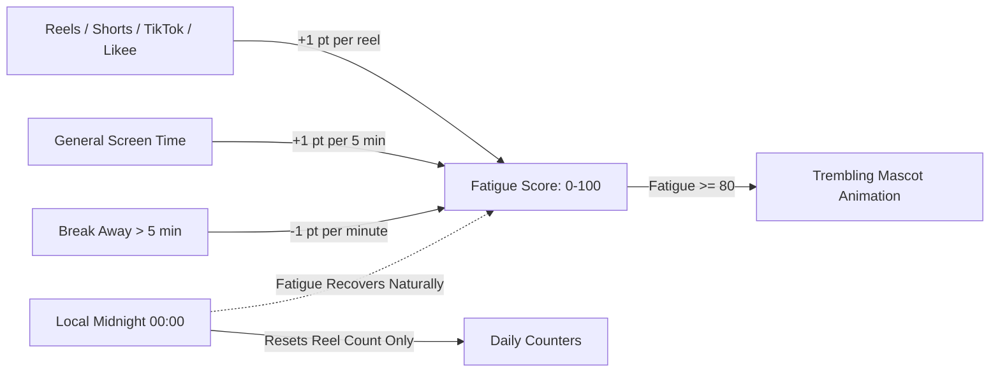

<div align="center">


# BrainBuddy — Mindful Anti-Doomscrolling Companion

### *An emotionally expressive, open-source Android digital wellbeing companion and short-video blocker*

**Protect your brain from algorithmic burnout. Block Reels, Shorts, TikTok and Likee. Watch your brain recover as you take mindful breaks.**

[](LICENSE)
[](#download)
[](#contributing)
[](#building-and-ci)

<br>

[**Download APK**](#download) · [**Privacy and Safety**](#privacy-and-safety-is-brainbuddy-safe) · [**Features**](#brainbuddy-features) · [**How Fatigue Works**](#how-brain-fatigue-and-recovery-works) · [**Supported Platforms**](#supported-platforms) · [**Credits**](#credits-and-acknowledgements) · [**License**](#license)

</div>

---

## Privacy and Safety (Is BrainBuddy Safe?)

For anyone concerned about privacy, data security, or permissions, here is what you need to know in plain language:

* **Zero Internet Access:** BrainBuddy does not request or possess the Android `INTERNET` permission. Android strictly blocks the app from sending even a single byte of data outside of your phone.
* **No Access to Personal Data:** The app cannot access your photos, files, camera, microphone, contacts, or location.
* **No Keystroke or Screen Recording:** The Accessibility Service is used strictly to spot video container IDs (like Reels or Shorts players) and navigate back or display the overlay. It cannot take screenshots or record what you type.
* **100% Offline and Open Source:** Every single line of code is published here on GitHub. There are no tracking SDKs, no accounts, and no advertisements.

---

## Why BrainBuddy?

You open Instagram or TikTok to check a quick message, and suddenly 45 minutes disappear into endless scrolling.

Traditional blockers either lock your entire phone or display annoying popups that you swipe away. 

**BrainBuddy** takes a different, emotional approach:
It pairs a **living, expressive cartoon Brain mascot** with reliable short-video blocking. As you scroll through Reels, Shorts, TikTok, or Likee, your little brain visually tires out. Step away for a break, and it gradually regains energy, smiling and standing tall again.

---

## BrainBuddy Features

### Living Cartoon Brain Mascot
An expressive companion that changes appearance based on your digital habits:
* **Pose 1: Energetic and Fresh (0–24 Reels / Fatigue):** Bright pink, sparkling eyes, joyful smile, confident posture.
* **Pose 2: Starting to Feel Tired (25–49 Reels / Fatigue):** Heavy eyelids, fading smile, slightly drooping posture.
* **Pose 3: Very Exhausted (50–99 Reels / Fatigue):** Noticeable dark circles, slouched body, visibly struggling.
* **Pose 4: Critically Drained (100 Reels / Fatigue):** Deeply slouched, tired expression, in urgent need of rest.

### Shivering and Trembling Animation
When fatigue reaches critical levels (**80 or higher**), the mascot physically **trembles and shivers** on screen, providing an immediate visual cue that your brain is overwhelmed by dopamine spikes.

### Dual-Rate Cognitive Fatigue Engine
* **Short-Form Algorithmic Feeds (Reels, Shorts, TikTok, Likee):** Rapid dopamine spikes exhaust the brain at **+1 point per reel** (or per 30 seconds).
* **General Screen Time:** Everyday app usage gently adds **+1 point per 5 minutes**.
* **Zero Battery Drain:** Calculated strictly through timestamp differentials when switching screens—no background wake locks or battery-draining loops.

### Timestamp-Based Natural Recovery
* **Grace Period:** The first **5 minutes** away from feeds incurs zero reduction.
* **Active Recovery:** After 5 minutes, your brain recovers **1 fatigue point per additional minute** away from feeds.
* **Midnight Handling:** Daily reel counter resets at local midnight, but fatigue recovers naturally through time rather than abruptly clearing.

### Non-Intrusive 20-Minute Break Reminder
When you continuously watch short videos for 20 minutes, BrainBuddy displays a non-blocking floating pill overlay:
> *"You've been scrolling for a while. Your little brain needs a break."*
* Does not interrupt playback or block screen taps.
* Automatically fades out after 6 seconds.
* Enforces a minimum **30-minute cooldown** and requires no notification permissions.

### Core Blocking Modes
* **Block All:** Instantly blocks every supported short-video feed.
* **Daily Limit:** Set a daily screen-time quota for short-form content.
* **Interval Timer:** Alternate between allowed viewing windows and mandatory mindful breaks.
* **Pause Timer:** Temporarily pause restrictions when you need quick access.
* **Usage Analytics:** Detailed local charts showing daily and weekly trends per app.

---

## Supported Platforms

BrainBuddy monitors and blocks short-form feeds while keeping messaging, profiles, and feeds usable:

* **Instagram:** Reels and Stories (DM videos exempted)
* **YouTube:** Shorts, YouTube Kids, and YouTube ReVanced
* **TikTok and TikTok Lite:** Feed player and video cover overlay
* **Facebook and Facebook Lite:** Reels and Stories
* **Snapchat:** Spotlight and Stories
* **Likee and Likee Lite:** Video player feeds

---

## How Brain Fatigue and Recovery Works



---

## Download

Download the latest pre-compiled APK directly from GitHub:

**[Download BrainBuddy APK](https://github.com/dev-talha/brain-buddy/actions)**

1. Download the latest `BrainBuddy-APKs` artifact from the GitHub Actions tab.
2. Install the `.apk` on your device (**Android 8.0 or newer**).
3. Open BrainBuddy and enable the **Accessibility** permission when prompted.
4. Set your wellbeing goals and let BrainBuddy keep your scrolling mindful.

---

## Building and CI

BrainBuddy features an automated **GitHub Actions CI/CD pipeline**—APKs are compiled and tested in the cloud without needing local development tools.

### Local Build Requirements
* JDK 21
* Android SDK 37 (compileSdk 37)
* Android Studio or Terminal

```bash
git clone https://github.com/dev-talha/brain-buddy.git
cd brain-buddy

# Run unit tests
./gradlew test

# Build Debug APK
./gradlew :app:assembleDebug

# Build Release APK
./gradlew :app:assembleRelease
```

---

## Project Architecture

```
brain-buddy/
├── app/                  # Application module, overlays, and Accessibility Service
├── core/
│   ├── domain/           # Brain fatigue engine, calculation logic, detection models and unit tests
│   ├── data/             # Repositories, persistence, and Room database
│   ├── designsystem/     # Mascot drawables, themes, and UI components
│   └── logging/          # Timber logging setup
└── feature/
    ├── home/             # Mascot UI cards, dashboard, and analytics timeline
    └── settings/         # Configuration, theme, and break schedules
```

---

## Credits and Acknowledgements

BrainBuddy is a fork of and inspired by the open-source project **[Scrolless](https://github.com/Xeven777/Scrolless)**, created by **Anish ([@Xeven777](https://github.com/Xeven777))** (which was originally inspired by [duartebarbosadev/scrolless](https://github.com/duartebarbosadev/scrolless)).

We extend our sincere gratitude to:
* **[Anish (Xeven777)](https://github.com/Xeven777)** for building the rock-solid accessibility detection architecture and blocking foundation in Scrolless.
* The open-source community for championing digital wellbeing and attention autonomy.

BrainBuddy builds upon that foundation by introducing the **emotional cartoon Brain mascot**, **shivering fatigue animations**, **dopamine-weighted screen-time math**, and **timestamp-based restorative recovery**.

---

## License

BrainBuddy is licensed under the **[GNU General Public License v3.0](LICENSE)**.

```
Copyright (C) 2026 BrainBuddy Contributors
Original work Copyright (C) 2026 Anish (Xeven777)
```

All bundled character artwork and mascot assets are licensed under the [ASSETS_LICENSE](ASSETS_LICENSE).
