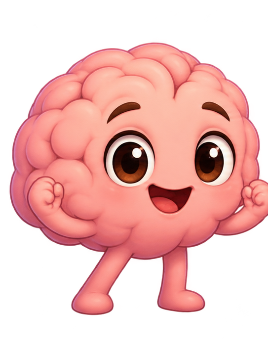
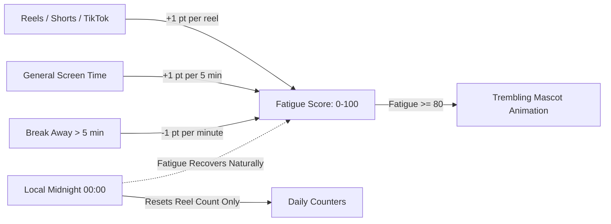

<div align="center">



# 🧠 BrainBuddy — Mindful Anti-Doomscrolling Companion

### *An emotionally expressive, open-source Android digital wellbeing companion and short-video blocker*

**Protect your brain from algorithmic burnout. Block Reels, Shorts, TikTok & Likee. Watch your brain recover as you take mindful breaks.**

[](LICENSE)
[](#-download)
[](#-contributing)
[](#-building-and-ci)

<br>

[**⬇️ Download APK**](#-download) · [**✨ BrainBuddy Features**](#-brainbuddy-features) · [**🧬 How Fatigue Works**](#-how-brain-fatigue--recovery-works) · [**📱 Supported Platforms**](#-supported-platforms) · [**🤝 Credits & Fork**](#-credits--acknowledgements) · [**📄 License**](#-license)

</div>

---

## 🤔 Why BrainBuddy?

You open Instagram or TikTok for *"just five minutes"*... and suddenly 45 minutes vanish into mindless scrolling. Your mind feels scattered, tired, and overstimulated. 😵‍💫

Traditional app blockers either lock your entire phone or display annoying popups that you immediately dismiss. 

**BrainBuddy** takes an emotionally resonant, mindful approach:
It pairs a **living, expressive cartoon Brain mascot** with powerful on-device short-form video blocking. As you scroll through Reels, Shorts, TikTok, or Likee, your little brain visually tires out. Take a break, and it gradually regains its energy, smiling and standing tall again.

> 🔐 **Privacy First:** BrainBuddy is **100% open source** and operates **entirely offline**. It uses Android's Accessibility Service strictly for local video detection. There are no analytics, no accounts, no ads, and no data uploaded to any server.

---

## ✨ BrainBuddy Features

### 🧠 Living Cartoon Brain Mascot & Poses
An adorable, expressive companion that changes appearance based on your digital habits:
* **Pose 1: Energetic & Fresh (0–24 Reels / Fatigue):** Bright pink, sparkling eyes, cheerful smile, and confident posture.
* **Pose 2: Starting to Feel Tired (25–49 Reels / Fatigue):** Heavy eyelids, fading smile, slightly drooping posture.
* **Pose 3: Very Exhausted (50–99 Reels / Fatigue):** Noticeable dark circles, slouched body, visibly struggling.
* **Pose 4: Critically Drained (100 Reels / Fatigue):** Emotionally vulnerable, deeply slouched, desperately in need of rest.

### ⚡ Shivering & Trembling Animation
When fatigue reaches critical levels (**$\ge 80$**), the mascot physically **trembles and shivers** on your screen, giving you an immediate emotional cue that your brain is overwhelmed by dopamine overload.

### ⏱️ Dual-Rate Cognitive Fatigue Engine
* **Short-Form Algorithmic Feeds (Reels / Shorts / TikTok / Likee):** Rapid dopamine spikes exhaust the brain at **+1 point per reel** (or per 30 seconds).
* **General Screen Time:** Everyday app use gently adds **+1 point per 5 minutes**.
* **Zero Battery Drain:** Derived entirely from timestamp differentials ($\Delta t$) on screen transitions—no background wake locks or battery-draining timer loops.

### 🍃 Timestamp-Based Healing & Recovery
* **Grace Period:** The first **5 minutes** away from feeds incurs zero reduction.
* **Natural Healing:** After 5 minutes, your brain recovers **1 fatigue point per additional minute** away from feeds.
* **Midnight Rollover:** Daily reel counter resets at local midnight ($00:00$), but fatigue recovers organically rather than abruptly resetting.

### 🔔 Non-Intrusive 20-Minute Break Reminder
When you continuously watch short videos for 20 minutes, BrainBuddy displays an elegant, non-blocking floating pill overlay:
> *"You've been scrolling for a while. Your little brain needs a break."*
* Does not block touch interactions or freeze playback.
* Automatically fades out after 6 seconds.
* Respects a minimum **30-minute cooldown** and requires zero notification permissions.

### 🛡️ Complete Suite of Core Blocking Modes
* 🚫 **Block All:** Instantly blocks every supported short-video feed.
* ⏳ **Daily Limit:** Set a daily screen-time quota for short-form content.
* 🔁 **Interval Timer:** Alternate between allowed viewing windows and mandatory mindful breaks.
* ⏸️ **Pause Timer:** Temporarily pause restrictions when you need quick access.
* 📊 **Usage Analytics:** Detailed local charts showing daily and weekly trends per app.

---

## 📱 Supported Platforms

BrainBuddy monitors and blocks short-form feeds while keeping messaging, profiles, and feeds usable:

* 📸 **Instagram:** Reels & Stories (DM videos exempted)
* 🔴 **YouTube:** Shorts, YouTube Kids & YouTube ReVanced
* 🎵 **TikTok & TikTok Lite:** Feed player & video cover overlay
* 📘 **Facebook & Facebook Lite:** Reels & Stories
* 👻 **Snapchat:** Spotlight & Stories
* 💜 **Likee & Likee Lite:** Video player feeds

---

## 🧬 How Brain Fatigue & Recovery Works



---

## ⬇️ Download

Download the latest pre-compiled APK directly from GitHub:

**👉 [Download BrainBuddy APK](https://github.com/dev-talha/brain-buddy/actions)**

1. Download the latest `BrainBuddy-APKs` artifact from the Actions tab.
2. Install the `.apk` on your device (**Android 8.0+**).
3. Open BrainBuddy and enable the **Accessibility** permission when prompted.
4. Set your wellbeing goals and let BrainBuddy keep your scrolling mindful! 🎉

---

## 🛠 Building and CI

BrainBuddy features a complete **GitHub Actions CI/CD pipeline**—you don't even need Android SDK or Java installed locally to compile and test it.

### Local Build Requirements:
* JDK 21
* Android SDK 37 (compileSdk 37)
* Android Studio or Terminal

```bash
git clone https://github.com/dev-talha/brain-buddy.git
cd brain-buddy

# Run unit tests
./gradlew test

# Build Debug APK
./gradlew :app:assembleDebug

# Build Release APK
./gradlew :app:assembleRelease
```

---

## 📦 Project Architecture

```
brain-buddy/
├── app/                  # Application module, overlays, and Accessibility Service
├── core/
│   ├── domain/           # Brain fatigue engine, calculation logic, detection models & unit tests
│   ├── data/             # Repositories, persistence, and Room database
│   ├── designsystem/     # Mascot drawables, themes, and UI components
│   └── logging/          # Timber logging setup
└── feature/
    ├── home/             # Mascot UI cards, dashboard, and analytics timeline
    └── settings/         # Configuration, theme, and break schedules
```

---

## 🤝 Credits & Acknowledgements

BrainBuddy is a fork of and heavily inspired by the incredible open-source project **[Scrolless](https://github.com/Xeven777/Scrolless)**, created by **Anish ([@Xeven777](https://github.com/Xeven777))** (which was originally inspired by [duartebarbosadev/scrolless](https://github.com/duartebarbosadev/scrolless)).

We extend our deep gratitude to:
* **[Anish (Xeven777)](https://github.com/Xeven777)** for building the rock-solid accessibility detection architecture and blocking foundation in Scrolless.
* The open-source community for championing digital wellbeing and attention autonomy.

BrainBuddy builds upon that foundation by introducing the **emotional cartoon Brain mascot**, **shivering fatigue animations**, **dopamine-weighted screen-time math**, and **timestamp-based restorative recovery**.

---

## 📄 License

BrainBuddy is licensed under the **[GNU General Public License v3.0](LICENSE)**.

```
Copyright (C) 2026 BrainBuddy Contributors
Original work Copyright (C) 2026 Anish (Xeven777)
```

All bundled character artwork and mascot assets are licensed under the [ASSETS_LICENSE](ASSETS_LICENSE).
